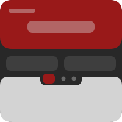
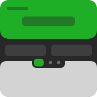
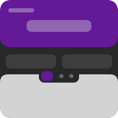
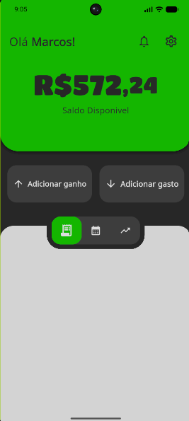
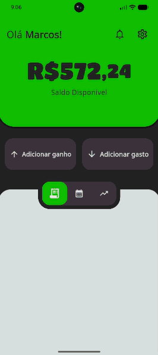

# App Financeiro

Projeto pessoal desenvolvido com Flutter com dois objetivos: praticar e aprofundar meus conhecimentos no desenvolvimento de aplicativos e me ajudar a organizar minhas finanças.

## Objetivo

O app pretende ajudar o usuário a acompanhar sua situação financeira e ter uma visão mais clara do que pode acontecer nos próximos meses.

## Previsão financeira mensal

A proposta principal é permitir que o usuário visualize uma estimativa de sua situação financeira futura com base no dinheiro que recebe, nos gastos e nos objetivos cadastrados. Essa previsão poderá ajudar a:

- entender quanto dinheiro poderá ter nos próximos meses;
- avaliar se conseguirá juntar dinheiro para uma meta;
- identificar com antecedência um possível saldo negativo ou endividamento;
- tomar decisões financeiras com mais planejamento.

As previsões serão estimativas baseadas nas informações registradas pelo usuário, não garantias de resultados.

## Funcionalidades planejadas

- Acompanhar o saldo e os lançamentos financeiros;
- Registrar ganhos e gastos;
- Visualizar informações por mês;
- Consultar previsões financeiras;
- Avaliar o progresso em direção a metas.

## Estado atual

O projeto está em desenvolvimento. Atualmente, há uma tela inicial com dados de exemplo e elementos visuais para ganhos, gastos e seleção do dashboard. Os registros, cálculos de previsão e persistência de dados ainda precisam ser implementados.

## Mudança de tema

O aplicativo permite personalizar as cores da interface pela tela de configurações.

Temas disponíveis:

- Vermelho
- Verde
- Amarelo
- Azul
- Rosa
- Roxo

A seleção é feita em **Configurações > Cores**. O tema atual é gerenciado pelo `ThemeApp` e aplicado aos elementos da interface, como fundo, botões, ícones e textos.

A implementação está em [app_colors.dart](/lib/config/app_colors.dart), [enum_colors.dart](/lib/config/enum_colors.dart) e [theme_widget.dart](/lib/screens/settings/widgets/theme_widget.dart).

## Temas disponíveis

<table>
  <tr>
    <td align="center">
      <br>
      Vermelho
    </td>
    <td align="center">
      <br>
      Verde
    </td>
    <td align="center">
      <br>
      Amarelo
    </td>
  </tr>
  <tr>
    <td align="center">
      <br>
      Azul
    </td>
    <td align="center">
      <br>
      Rosa
    </td>
    <td align="center">
      <br>
      Roxo
    </td>
  </tr>
</table>

## Capturas de tela

### Tela inicial



### Demonstração da animação da Dashboard



## Tecnologias

- Flutter e Dart
- `intl` para formatação de valores
- `flutter_svg` para suporte a ícones SVG

## Executar o projeto

Com o Flutter instalado, execute:

```bash
flutter pub get
flutter run
```

## Licença

Este projeto está sob a licença MIT. Consulte o arquivo [LICENSE](LICENSE) para mais detalhes.

## Licenças de terceiros

O código original deste projeto está sob a licença MIT. As fontes Oswald, Coiny, Cherry Bomb One e Science Gothic incluídas no app são distribuídas sob a SIL Open Font License, versão 1.1 (OFL). As fontes mantêm suas próprias condições de licença; a MIT do projeto não as substitui.